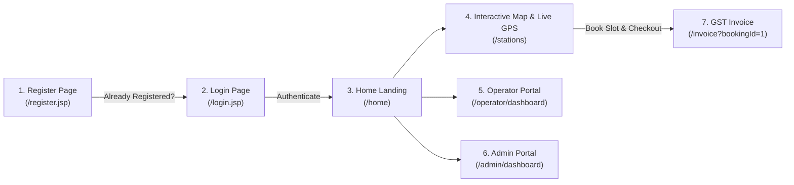

# ⚡ VoltSpot EV - Charging Station Finder & Slot Booking Platform

<p align="center">
  
  
  
  
  
  
  
  
</p>

An enterprise-grade, full-stack electric vehicle (EV) charging infrastructure discovery and slot reservation platform built for the Indian EV ecosystem with **Java Servlets, JSP, JDBC, MySQL 8.0, Apache NetBeans IDE 24, Apache Tomcat 9.0.84, Google Maps JavaScript API, and WebGL2 Antigravity Physics Engine**.

---

## 🗺️ Live Application Flow & Sequential Routing

All 7 core modules and portals operate seamlessly on a single host (`http://localhost:8080/voltspot-ev-booking/`):



1. **Register Page (`/register.jsp`)**: Entrypoint for new visitors; choose **EV Driver** or **Hub Operator**, with a direct 1-click **"Open Login Page"** navigation bar for existing users.
2. **Login Page (`/login.jsp`)**: Perfectly centered glassmorphic login card with 1-click instant demo profile loaders (Admin, Operator, User) and interactive Antigravity particle palette switcher (**Emerald ⚡** / **Cosmic 🔥**).
3. **Home Landing (`/home`)**: Live network counter statistics, rapid city filters, GPS location locator, and verified station showcase cards.
4. **Interactive Map & Live GPS (`/stations`)**: Continuous live GPS tracking (`watchPosition`), custom pulsing blue radar beacon, accuracy radius circle, quick city jumper, nearest hub finder, and exact Google Maps turn-by-turn driving directions.
5. **Operator Portal (`/operator/dashboard`)**: Operator metrics, station management, booking status updater, and **Register Station** with interactive Google Maps draggable pin and Google Places autocomplete coordinate picker.
6. **Admin Portal (`/admin/dashboard`)**: System-wide oversight, pending station approval queue, user activation/deactivation, payments ledger, and financial reports.
7. **GST Tax Invoice (`/invoice?bookingId=1`)**: Authentic Indian GST Tax Invoice featuring 18% GST (9% CGST + 9% SGST) breakdown, HSN/SAC code `998714`, QR verification, and print-ready formatting.

---

## 📍 Exact Google Maps Locations & Live GPS Tracking

Every charging hub in the platform is pinned to verified real-world landmarks with exact latitude and longitude:

| EV Station | Exact Google Maps Landmark | Coordinates | Ports & Rates |
| :--- | :--- | :--- | :--- |
| **VoltSpot MG Road Hub** | MG Road Metro Station, Bengaluru, Karnataka | `12.971600, 77.594600` | 150kW DC (₹280) • 22kW AC (₹95) |
| **VoltSpot Cyber Towers Hub** | Cyber Towers, Hitec City, Hyderabad, Telangana | `17.450400, 78.381100` | 120kW DC (₹260) • 22kW AC (₹90) |
| **VoltSpot BKC Platinum Hub** | G-Block, Bandra Kurla Complex, Mumbai, Maharashtra | `19.065700, 72.868700` | 180kW DC (₹320) • 50kW AC (₹120) |
| **VoltSpot Connaught Place** | Outer Circle, Block F, Connaught Place, New Delhi | `28.631500, 77.216700` | 150kW DC (₹290) • 22kW AC (₹95) |
| **EcoCharge OMR Tech Corridor** | Rajiv Gandhi Salai, Thoraipakkam, Chennai, Tamil Nadu | `12.934500, 80.231200` | 120kW DC (₹250) • 22kW AC (₹90) |
| **EcoCharge Hinjewadi IT Park** | Phase 1, Infosys Circle, Hinjewadi, Pune, Maharashtra | `18.591300, 73.738900` | 120kW DC (₹240) • 22kW AC (₹85) |
| **VoltSpot Whitefield ITPL Hub** | ITPL Main Road, Whitefield, Bengaluru, Karnataka | `12.986300, 77.730800` | 60kW DC (₹200) • 22kW AC (₹80) |

- **Continuous GPS Live Tracking**: Animated pulsating blue beacon (`.user-live-gps-radar`) tracks user movement in real-time with an accuracy circle showing GPS precision in meters.
- **Dynamic Haversine Distance**: Station cards update their distance in kilometers live (`2.4 km away (Live GPS)`).
- **1-Click Live Driving Directions**: Passes user's live coordinates directly into Google Maps:
  `https://www.google.com/maps/dir/?api=1&origin={userLat},{userLng}&destination={stationLat},{stationLng}&travelmode=driving`
- **1-Click Exact POI Pin**: Opens the exact location on Google Maps:
  `https://www.google.com/maps/search/?api=1&query={stationLat},{stationLng}`
- **Google Maps Persistent API Key Connector**: Enter your Google Maps JavaScript API key via the top navbar modal; safely saved in browser `localStorage`. Seamless Leaflet/OpenStreetMap fallback operates automatically if an API key is not present.

---

## 🌌 Continuous Antigravity WebGL2 Particle Simulation Engine

Integrated directly from React Bits, adapted for full-page vanilla WebGL2 with Canvas 2D fallback:
- **Continuous Fluid Harmonic Motion**: Particles continuously orbit and swirl around the mouse cursor or keyboard-focused element (<kbd>Tab</kbd>) in an ~8-second fluid sinusoidal wave cycle (`slowWave = Math.sin(time * 1.6 + seeds * 6.28) * 0.35`).
- **Keyboard "Tabbing" Tracking**: Pressing <kbd>Tab</kbd> or <kbd>Shift</kbd>+<kbd>Tab</kbd> smoothly glides the particle vortex to the exact center of the active input, button, or link.
- **Subtle Ambient Backdrop**: Particles outside the cursor/tab radius maintain a calm, gentle drift.
- **Luxury Glassmorphism & Micro-animations**: Frosted glass panels (`rgba(15, 23, 42, 0.84)`, blur `16px`) with `@keyframes panelSlideUp` entrance animations.

---

## 🔑 Demo Accounts

| Role | Email | Password | Access Capabilities |
| :--- | :--- | :--- | :--- |
| **Central Administrator** | `admin@voltspot.in` | `admin123` | Station approval queue, user toggles, payments audit, system reports |
| **Hub Operator** | `operator@voltspot.in` | `operator123` | Manage stations, update booking statuses, register new hubs |
| **EV Driver (User)** | `user@voltspot.in` | `user123` | Book charging slots, live GPS station discovery, UPI checkout, GST invoices |

*(The login page includes 1-click instant fill buttons for each role).*

---

## 🚀 How to Run

### Option A: 1-Click Localhost Server (Node.js)
```bash
# Start local server on port 8080
node server.cjs
```
Open **[http://localhost:8080/voltspot-ev-booking/](http://localhost:8080/voltspot-ev-booking/)** in your browser.

### Option B: Apache NetBeans IDE 24 & Apache Tomcat 9.0.84
1. **MySQL Setup**: Open MySQL Workbench 8.0 and execute `backend/database/voltspot_database_setup.sql`.
2. **NetBeans Project**: Open Apache NetBeans IDE 24, click **File > Open Project**, and select the `backend` folder.
3. **Configure Server**: Right-click project > **Properties > Run**, select **Apache Tomcat 9.0.84**, and click **Run** (or press <kbd>F6</kbd>).
4. Application opens automatically at `http://localhost:8080/voltspot-ev-booking/`.

---

## 📜 License
Developed by **k Rajesh** ([@rajesh911-ui](https://github.com/rajesh911-ui)). Released under the MIT License.
